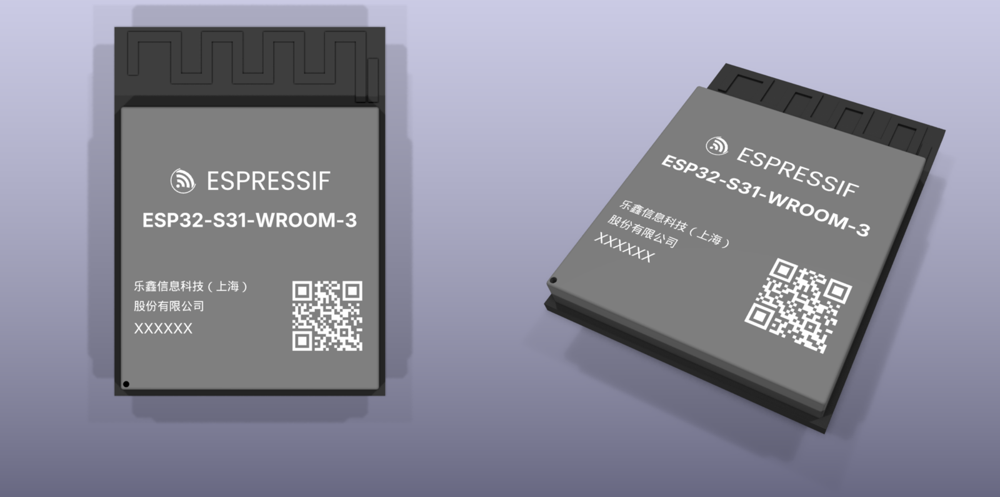
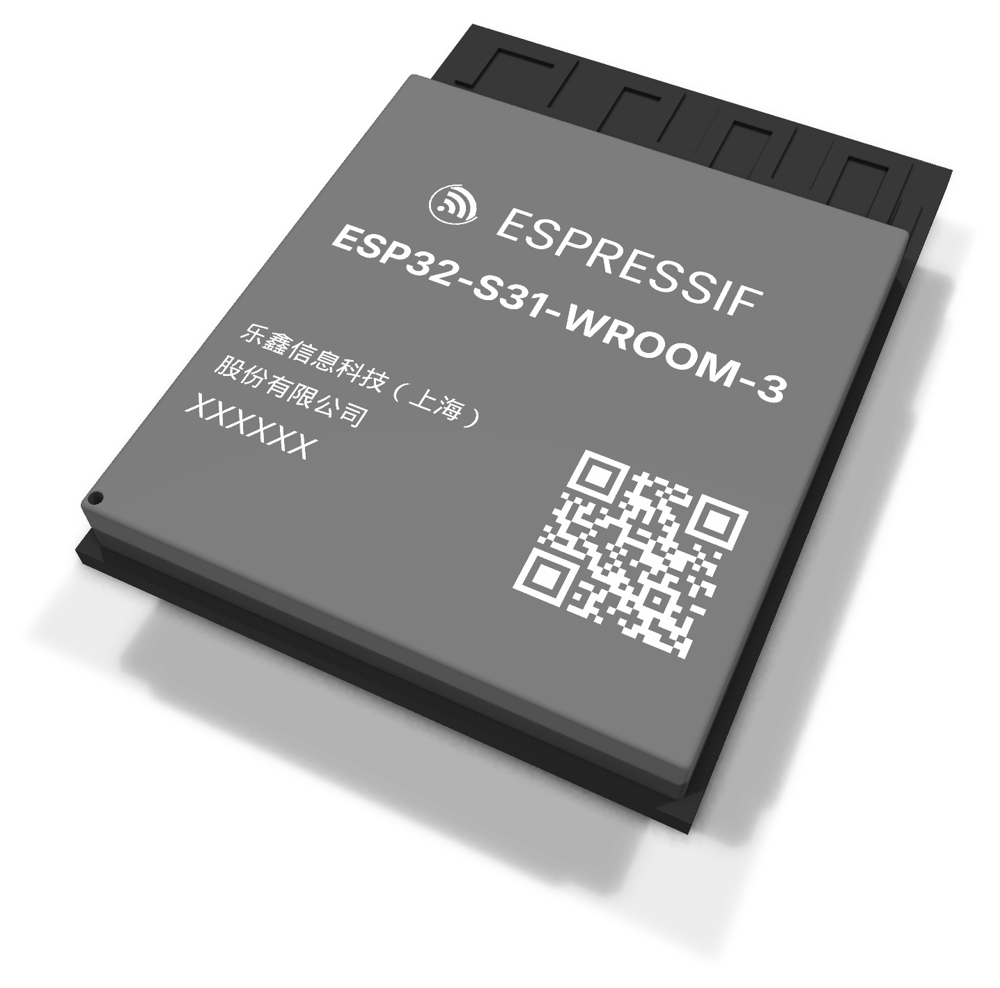
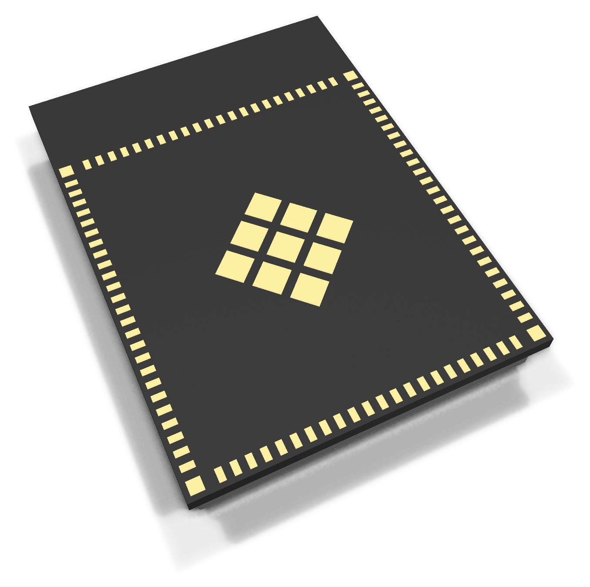

# ESP32-S31-WROOM-3 — STEP 3D model

> **Reference / starting point:** KiCad symbol and footprint for the ESP32-S31-WROOM-3 by **DanielFliman**
> **→ <https://github.com/DanielFliman/ESP32-S31-WROOM-3-KiCad-Schematic-Footprint>**
>
> This repository adds only the matching **3D model**. Use it together with a footprint that has its origin at the centre of the pad field.

A detailed STEP model of the Espressif **ESP32-S31-WROOM-3** module (Wi-Fi 6, Bluetooth 5.4, IEEE 802.15.4) for KiCad and other MCAD/ECAD tools.

| Front | Back |
|:---:|:---:|
|  |  |

## Contents

| Path | What |
|------|------|
| `3d/ESP32-S31-WROOM-3.step` | 3D model (STEP AP214, colours, millimetres) |
| `images/` | Renders used in this README (KiCad 10 raytracer) |

## Model

Dimensions follow the *ESP32-S31-WROOM-3 & WROOM-3U Datasheet* v0.7, Fig. 10-1 and Fig. 11-1:

- **Module:** 22 × 30 × 3.5 mm; module PCB 1.0 mm; 6 mm antenna area at the top.
- **Shield can:** 21 × 23 mm, 0.5 mm from the left, right and bottom edges, 0.25 mm edge radius, Ø 0.5 mm marking dot in the lower-left corner.
- **Pads:**
  - 94 LGA pads 0.4 × 0.8 mm at 0.85 mm pitch,
  - 4 corner pads 0.8 × 0.8 mm,
  - the 9-square EPAD (1.8 mm, rotated 45°).
- **White shield marking:**
  - inlaid 0.02 mm, so the height stays 3.5 mm,
  - contains the logo, the part number, the manufacturer lines, a lot-code placeholder and a real QR code (`ESP32-S31-WROOM-3-N16R32V`),
  - layout follows the Espressif product photo; the logo and wordmark are approximations.
- **Antenna meander:** representative only. It does not reproduce the module's actual antenna geometry.
- **Style:** colours and overall look follow the KiCad library model of the ESP32-S3-WROOM-2.

## Using it in KiCad

The model origin is the **centre of the pad field** (pin field ±12 mm, antenna towards −Y in KiCad), with Z = 0 at the board surface.

1. Open the footprint properties → *3D Models*.
2. Add `ESP32-S31-WROOM-3.step` with offset 0 / 0 / 0, rotation 0 / 0 / 0 and scale 1.

If your footprint has its origin somewhere else (e.g. on pin 1), set the offset accordingly.

## License

The 3D model is released under **CC-BY-SA 4.0 with the KiCad library exception** — the same terms as the official KiCad libraries.
You can use it in any PCB design (including closed-source and commercial ones) without the design falling under CC-BY-SA.
Modified versions of the files themselves must keep attribution and stay under CC-BY-SA 4.0. See [LICENSE.md](LICENSE.md).

## Disclaimer

- The datasheet is **preliminary (v0.7)**. Check dimensions against the current Espressif documentation before ordering boards.
- *Espressif*, *ESP32* and the Espressif logo are trademarks of Espressif Systems. The marking on the model only visualises the product. Trademarks are not covered by the license. This project is not affiliated with Espressif.
